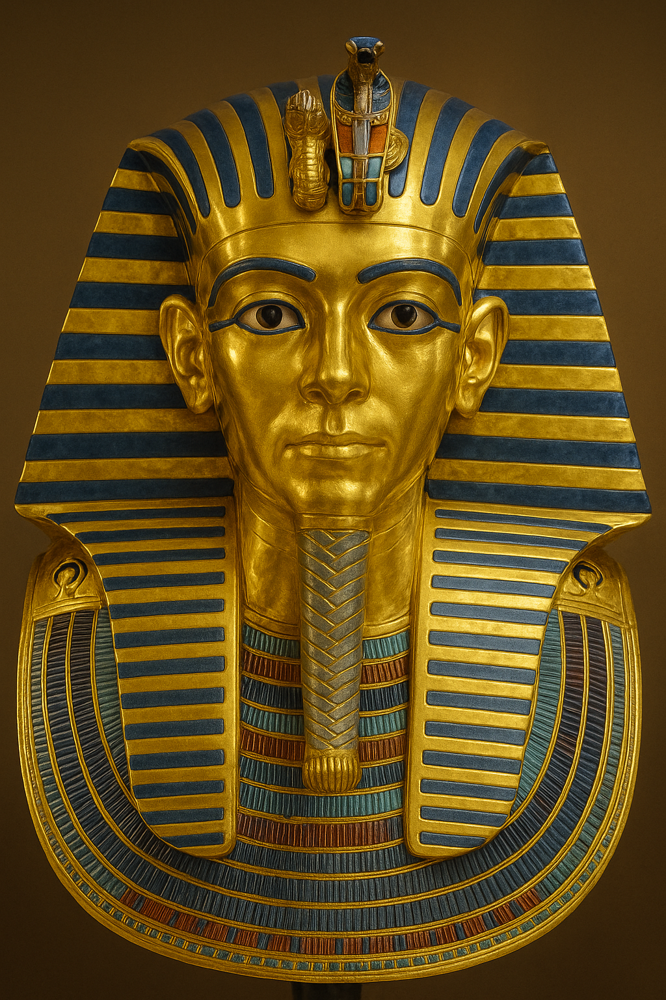
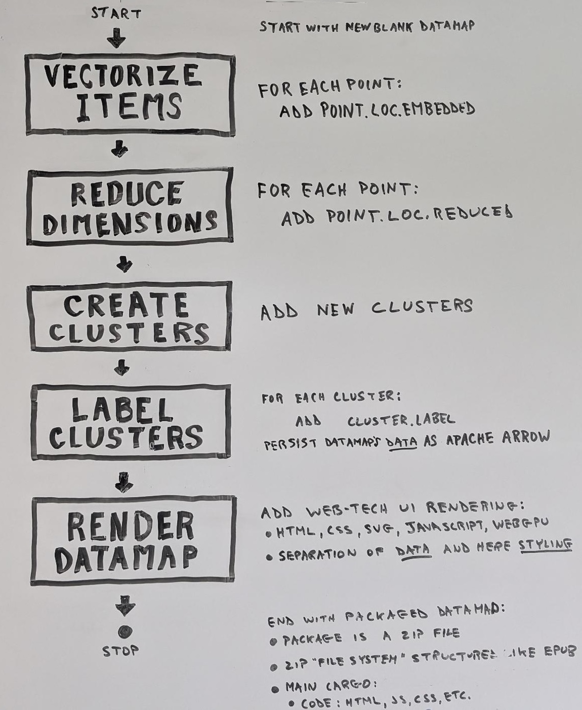
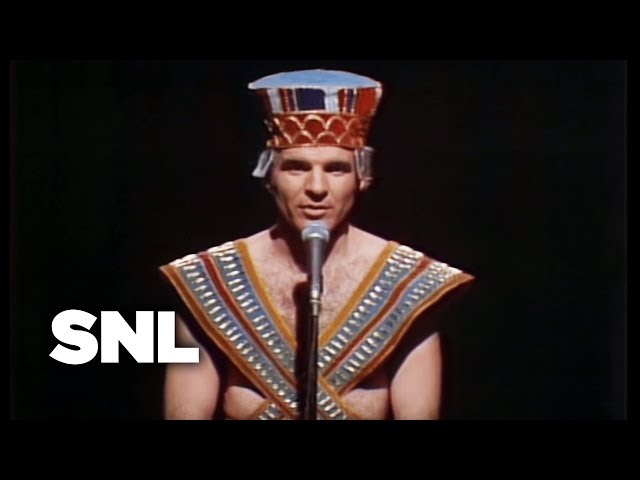
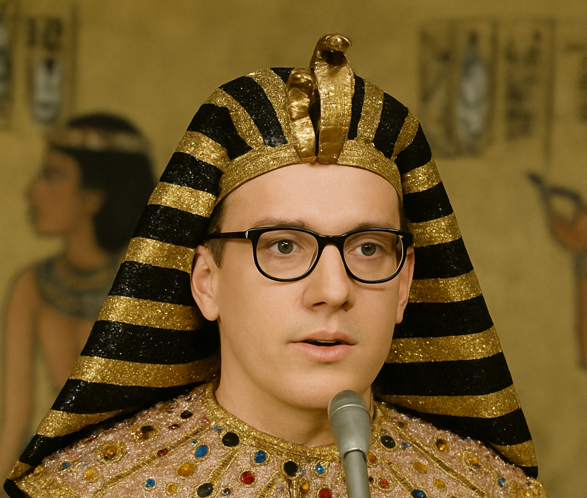

# King Tutte Datamap Scrolls

The live demo datamap will actually use data from Ai2's Sementic Scholar library. Seeing as the meetup is at Ai2, that would certainly seem relevant to any Ai2 folks in the audience.

More broadly the big take-away is that datamaps are a new visualization technique that every AI practitioner should have in their toolbox, and these datamaps are all based on permissively licensed open source.

The announcment says "If your build... explores what current frameworks just barely support." Datamaps are a match. The best-of-breed FOSS datamap framework can currenly handle millions of datapoints, even some tens of millions. But the demo datamap is only a subset of Semantic Scholar's data. A full datamap would require handling ~200 million datapoints, while the biggest datamap yet is on the order of 60 million datapoints. So, a full Semantic Scholar datamap is right on the edge of what is just now becoming possible.

Quoting the announcement again, "This is about enabling a fellow tinkerer." Within a year or so I believe datamaps will be everywhere. Datamaps will soon be a tool developers reach for whenever they need to take a first look at their data. Datamaps are extremely useful diagnostic instruments for all manner of AI dev tinkering. All via open source -- that's enabling.

Quoting again, "AI Tinkerers and the Allen Institute for AI are teaming up to surface the projects sitting right at the boundary between research and production."  Datamaps are crossing that boundary as we speak. The adoption of datamaps has already affected researchers in fields as diverse as NLP all the way to single cell genomics. Now datamaps are being commercialized, with at least two start-ups providing datamapping as a service. Datamaps will be seen all over the AI landscape within a year, from researchers curating data to end-users controlling RAG system in chatbot interfaces.

[I was talking to Joe at the end of the recent gathering at Fenwick & West on the 29th, "AI Trust & Security in AI: Demo Night." He said I should submit a datamap demo proposal. So, here it is.]

Datamaps are a new visualization technique custom designed for vector databases, RAG systems, or more generally any collection of embedding vectors, that is any "AI-ready data." The best-of-breed datamap tooling are permissively licensed open source.

This lightning talk explains what datamaps are by providing a live interactive demo of Ai2 Semantic Scholar's curated library of scientific papers. The demo shows to how to DIY code up datamaps via open source.  The (pre-cooked) example datamap would be a single static HTML page which each attendee can simultaneous load onto their phone and interact with. Here is the datamap they would experience:

https://connoiter.com/datamap/55948af4-903c-41cb-997e-a1dfda45eb5f/

This repo is a how-to manual for building "King Tutte pipelines,"
which generate
[datamaps](https://www.youtube.com/watch?v=r8dWZX8IGw8&ab_channel=PyData)
of collections of embedding vectors. These pipelines are assembled
from permissively licensed open source components developed primarily by the
[The Tutte Institute for Mathematics and Computing
(TIMC)](https://www.cse-cst.gc.ca/en/mission/research-cse/tutte-institute-mathematics-computing)
out of Canada, hence the name "King Tutte."

  
  
Funerary mask of Bill Tutte

## Introduction

Large collections of neural embedding vectors are proliferating
rapidly. For example, at its core every vector database and RAG
knowledge base consists of such a collection. Datamaps are
visualizations of embedding vector collections implemented
via modern web technologies such as HTML, WebGL/WebGPU, JavaScript,
CSS, etc. They provide a graphical overview of a collection and enable
interactive exploratory data analysis.

These "scrolls" (read: code, documentation, recorded tech talks, and
associated commentary) are an agglomeration of permissively licensed
repos and web content related to building datamaps, the bulk of which
originates out of the **Tutte** Institute of Canada -- hence the nod
to them in this repo's name.

The **goal** of this King Tutte Scrolls repo is to create **a one-stop
shop for datamapping** enabling any developer (human and/or
[agentic](https://simonwillison.net/2025/Sep/18/agents/)) looking to
produce datamaps of any "AI-ready data," that is, data with embedding
vectors. If necessary, the production process can include creating the
embedding vectors themselves from input data not originally
vectorized.

Note that this repo can be built into an **Agent Skill** (as 
[defined by Anthropic](https://www.anthropic.com/engineering/equipping-agents-for-the-real-world-with-agent-skills))
for use by software development tools and agents. See [connoiter.com
for pre-built Agent Skill
distros](https://connoiter.com/king_tutte_scrolls/distros/).

## King Tutte pipelines

Multiple Tutte Institute tools can be chained together into pipelines
that produce datamaps, which herein are called King Tutte
pipelines. These Tutte Institute tools include:
- UMAP
- HDBSCAN, 
- DataMapPlot
- Toponymy
- EVōC
- TNT
- Vectorizers
- Glasbly

Some of the tools are simply combinations of their tools configured for a
specific use case. For example,
[EVōC](https://github.com/TutteInstitute/evoc) is essentially just
UMAP followed by HDBSCAN (two separate Tutte Institute innovations),
with both components tuned for the purpose of working with embedding
vectors.

For pedological purposes, ignore such valuable optimizations for now. The core
architecture of King Tutte pipelines has a regular structure.

Note that although the Tutte Ilnstitute folks are the ones who did all
the original work, they did release their work as permissively
licensed open source, and so others have since contributed. For
example, the original implementation of UMAP is distributed as the
package,
[umap-learn](https://pypi.org/project/umap-learn/). Subsequently, as
part of their RAPIDS initiative NVIDIA banged out an implementation of
UMAP that runs on their hardware, even [claiming speed-ups as high as
300x over
umap-learn](https://medium.com/rapids-ai/rapids-24-08-better-scalability-performance-and-cpu-gpu-interoperability-f88086386da6)
(300 times faster, not 300 percent faster!). That code is licensed
under the Apache 2.0 license so, of course, the King Tutte Scrolls
include implementations which use NVIDIA's version. This is not the only
instance where non Tutte Institute code is used herein. There is also
[torchDR](https://github.com/TorchDR/TorchDR) and the list goes on.
As long as the code is high quality and permissively licensed (Apache,
MIT, BSD, etc.) it is fodder for the King Tutte Scrolls. 

## Use cases

These King Tutte Scrolls have multiple envisioned use cases.

### Self-study

A **solo human coder** can use the King Tutte Scrolls for
self-study. The content (code and docs previously written by others)
has been curated and commentary has been included. 

This repo will include as a submodule the Jupyter notebooks of a
related repo, [the King Tutte Datamapping Codex](https://github.com/Connoiter/king_tutte_datamapping_codex).
Most of those notebooks are not original work from Connoiter. The have
been modified from the originals as needed to make them work
out-of-the-box on Google's Colab.

Experimenting and modifying the code on Colab is which is a good place
to start. A pre-rendered build of the King Tutte Datamapping Codex
Jupyter Book is [ hosted on connoiter.com](*TBD*).

### Workshops

One of the deliverables of this repo is a Jupyter Book (v2) known as
the King Tutte Pipelines Jupyter Book.  For **conference workshop
contexts**, it includes Jupyter notebooks guaranteed to run on
Colab. Most of that code has been previously written elsewhere but
they have been tweaked as needed to ensure they all work out of the
box on Google's Colab service. (Similarly, the same goes for the
documentation: most was written elsewhere, and as needed simply
converted from ReStructure Text (for Sphinx) to MyST (for Jupyter
Book 2)).

For workshops, a Colab-based set-up is:
- free
- including optional free GPUs, which King Tutte tools know how to use
- involved no set-up hassles beyond asking for a GPU runtime
- is scalable for large workshops

So, a workshop can quickly get started, and after the workshop is
completed, attendees can continue to hack on their own versions of the
notebooks they were working on at the workshop, which should help
diffuse these datamap innovations.

### Agent Skill

[Simon Willison's definition of agent](https://simonwillison.net/2025/Sep/18/agents/) 
is: "An LLM agent runs tools in a loop to achieve a goal." That is the definition
used herein. In October of 2025, Anthropic defined 
[Agent Skills](https://www.anthropic.com/engineering/equipping-agents-for-the-real-world-with-agent-skills)
which is a type of tool for agents to use.

An agent can immediately make use of this repo simply by telling it to
check out [connoiter.com](https://connoiter.com). It should find, via
the llms.txt file on connoiter.com, the content of this repo built as
an Agent Skill available as a sub-tree of HTTP Collections on
connoiter.com.

The same Agent Skill just mentioned is also available packaged a ZIP files.
See [connoiter.com for pre-built Agent Skill
distros](https://connoiter.com/king_tutte_scrolls/distros/).
For more on how to build and deploy the same Agent Skill see
later in this document, in [the Building section](#building).)

## Tut juxt Tutte

“Humor can be dissected, as a frog can, but the thing dies in the process” ― E.B. White

### The Tutte Institute

<figure>
    
</figure>

[The Tutte Institute for Mathematics and Computing
(TIMC)](https://www.cse-cst.gc.ca/en/mission/research-cse/tutte-institute-mathematics-computing)
is a Canadian government-funded research institute, named after
[W. T. Tutte](https://en.wikipedia.org/wiki/W._T._Tutte). Bill Tutte
was a British code breaker and mathematician. During WW2, he
worked alongside the likes of Alan Turing cracking the Nazi's
encrypted comms at Bletchley Park. Later he became a Canadian citizen.

Notably, Tutte worked to crack the German High Command communications
code known by the Allies as “Fish,” an even tougher nut to crack than
the more well-known Enigma machine. Feel free to nerd out on tools he
developed such as the Δ and double-delta methods, wherein the hacker
digitally simulated mechanical wheel-based crypto communiction boxes
such as the Enigma machine. It can be thought of as an en silico
picking of physical locks by tuning into (via XOR filters on bit
streams) their encrypted digital broadcasts. 

  
  
The teleprinter for the Lorenz cipher machine

The reason why this work was more impressive than cracking Enigma is
that during the war the Allies never captured a Lorenz machine (which
generated Fish code). In contrast, for Enigma they did acquire a
machine including its code books, which proved quite handy while
reverse engineering the Enigma machine, otherwise all one'd have to go
on is intercepted ciphertext broadcast to work it all out. :(

  

Perhaps his work which is closest to this datamap technology is to be
found in his 1963 paper, [How to Draw a
Graph](https://www.semanticscholar.org/paper/How-to-Draw-a-Graph-Tutte/959258cb7ff636fee908e6f6877388081ca706b6).
But that is just a tangential curiosity since these King Tutte
pipelines use UMAP which is a force-directed method (a.k.a. spring
embedder), and Bill used different methods to plot a 2D map of
datapoints.

### King Tut

In ancient Egypt during the late Eighteenth Dynasty, King Tutankhamun,
also known as **King Tut** (not Tutte), was an Egyptian pharaoh who
ruled around 1332 to 1323 BC. King Tut has been immortalized in song,
as [can be seen on
YouTube](https://www.youtube.com/embed/k-fc3UrLRLQ?autoplay=1&mute=1&loop=0).

  

### King Tutte

Note, although the core software and documentation in this repo were
developed by the Tutte Institute, the term "King Tutte" and this repo
are ideas out of the start-up, Connoiter. There is **no relation** between
the two organizations. 

Blame Connoiter for the lighthearted tone of this project. In
contrast, the Tutte Institute is a serious Canadian government
research institute whose technology they have open sourced -- and
which is used herein -- was partially developed for use by Five Eyes
nations for cyberdefense purposes. No joke.

 
<a href="https://www.rhino.com/article/live-from-new-york-its-king-tut">Joke via Rhino</a>

As to the spelling of "datamap" versus the (currently) more common
"data map," that too was a decision made by Connoiter. If "dataset" and
"datapoint" can be single words, why you hating on "datamap?"

## Repo structure

This repo is an assemblage of multiple repos and variants thereof. It
is a corpus for use when building datamapping software. Separate repos
are included as git submodules if possible.

Very little of the content herein is original work by Connoiter. The
value is mostly in having a single source to go to when
datamapping. This value is most clearly demonstrated by the packaging
of this information into an Agent Skill (BTW, "Claud Skill" is the
name that

- External as-is repos as submodules
  - KTS makes no changes to the content of the repos
  - Goal is simply to one-stop-shop agglomerate relevant info
- For Colab-based workshops, some Jupyter notebooks from the
  (permissively licensed) external as-is repos have been copied and
  modified, and packaged as a Jupyter Book (whose Jupyter notebooks
  just so happen to run out-of-the-box on Colab). In an ideal world,
  there would be only on version, but in Colab Google has done some
  "embrace and extend" work that requires separate variants of the
  notebooks. C'est la vie.

# Building

Or equivalently use
[gitinjest](https://github.com/coderamp-labs/gitingest); connoiter.com
simply hosts the pre-rendered results of running this repo through
gitinjest.

One convenient deploy option is run individual Jupyter notebooks on
Colab. See [the list of Colab-ready notebooks]() in this repo.

Bonus, it would be trivial to run this repo through
[gitingest](https://github.com/coderamp-labs/gitingest) and feed the
markdown-based output to a transformer-based LLM programming tools,
agent or otherwise.

With this repo in its context window, it should be able to crank out
Python code to make datamaps, which are webUI(HTML&JS&c.) widgets that
run live inside notebooks (Jupyter and Marimo) or can be exported as
stand-along static file HTML web-apps that can be run in browsers
later.

For convenience, a pre-built run of this repo through gitingest is
available at:

https://connoiter.com/king_tutte_scrolls

Or just tell your coding LLM to check out
[connoiter.com](https://connoiter.com), and it will find the King Tutte Scrolls via the
site's llms.txt file.

## Contributing

PRs welcome! We use [the GihHub Flow](https://docs.github.com/en/get-started/using-github/github-flow) for coordinating. Fork and PR. Follow [GitHubs instructions](https://docs.github.com/en/get-started/exploring-projects-on-github/contributing-to-open-source#cloning-a-fork-of-a-project).

Finally, the academic types such as the researchers at the Tutte
Institute live and die by citations so giving thanks via a citation
is the best bang for buck way of contributing. See specific repos for 
how to cite. For example:
- [UMAP citing](https://github.com/lmcinnes/umap?tab=readme-ov-file#citation)
- [HDBSCAN citing](https://github.com/scikit-learn-contrib/hdbscan?tab=readme-ov-file#citing)

